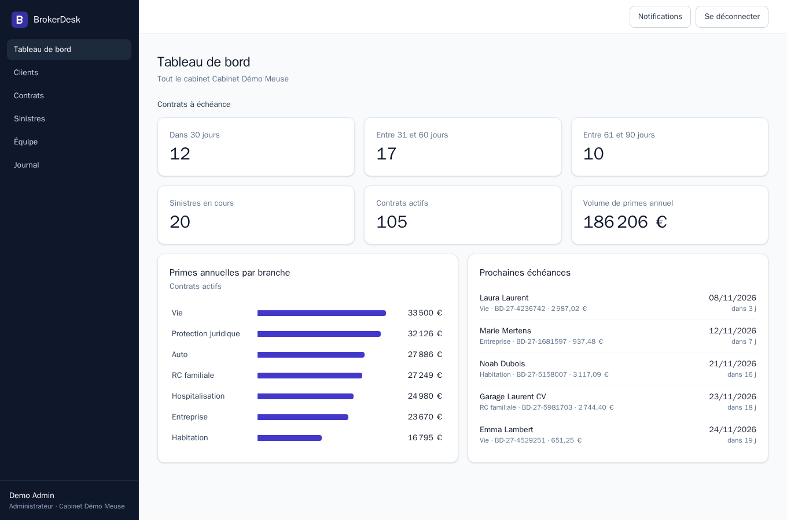
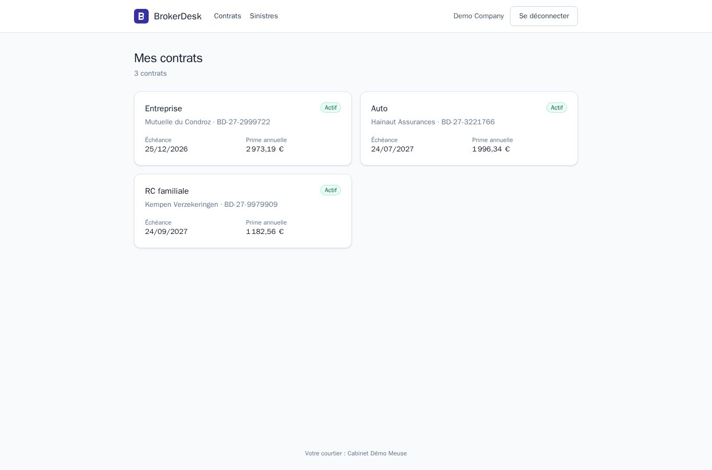
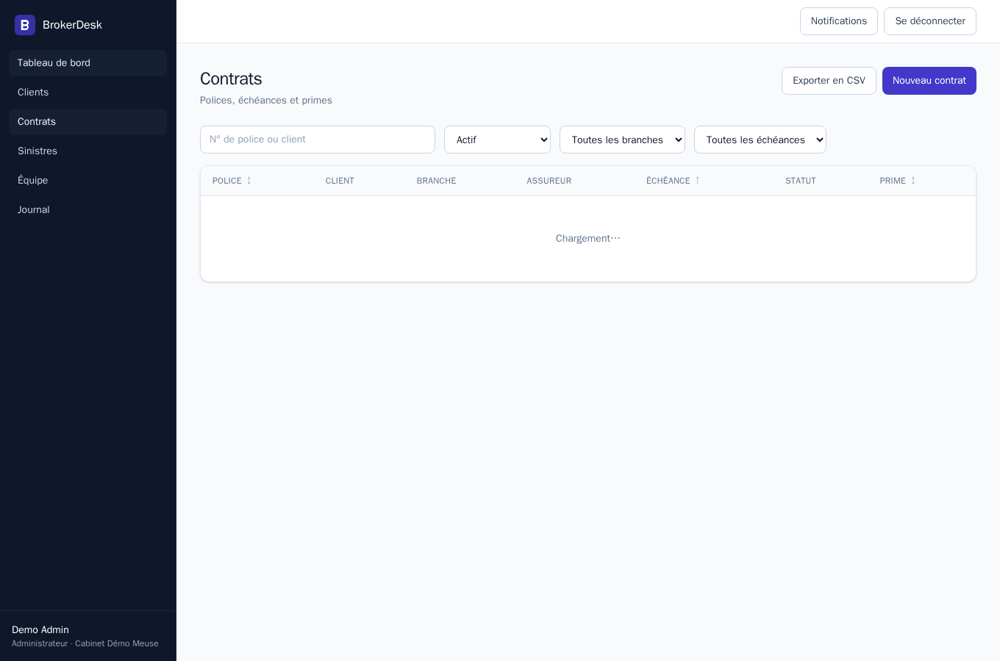
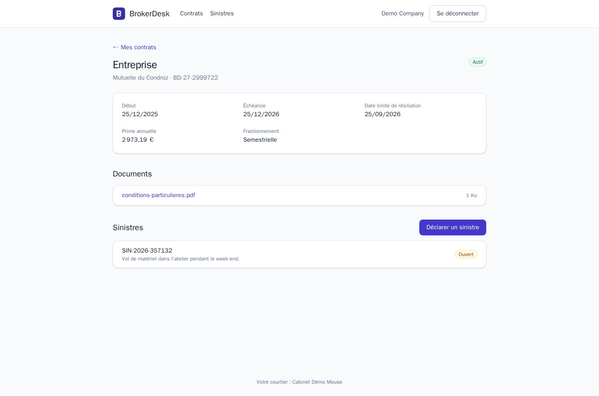
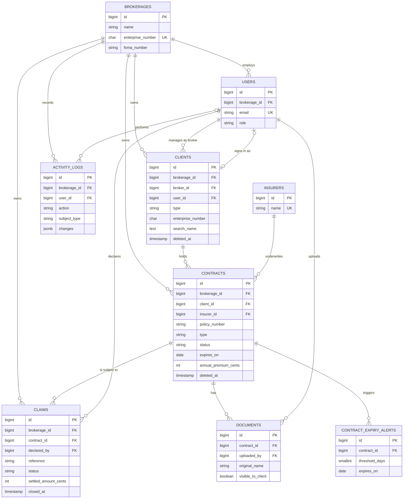

# BrokerDesk

A mini-SaaS for Belgian insurance brokers: they manage clients, contracts, renewals and claims, while policyholders follow theirs in a separate portal.

[](https://github.com/DonkeyhTv/brokerdesk/actions/workflows/ci.yml)


| Broker dashboard | Client portal |
| --- | --- |
|  |  |
|  |  |

## Try it online

No installation needed. The login pages offer these accounts in one click:

| Account | Application | Email | Password |
| --- | --- | --- | --- |
| Brokerage admin | [Back office](https://brokerdesk.steve-amissi.be) | `admin@example.be` | `password` |
| Broker | [Back office](https://brokerdesk.steve-amissi.be) | `broker@example.be` | `password` |
| Individual client | [Client portal](https://portail.brokerdesk.steve-amissi.be) | `client@example.be` | `password` |
| Company client | [Client portal](https://portail.brokerdesk.steve-amissi.be) | `company@example.be` | `password` |

The admin sees the whole brokerage, the broker only their own portfolio, and each client only their own contracts. Feel free to create, edit or delete anything: all data is reset every night. The [API documentation](https://brokerdesk.steve-amissi.be/docs/api) is public too.

## Run it locally

Docker is the only requirement:

```sh
git clone https://github.com/DonkeyhTv/brokerdesk.git
cd brokerdesk
docker compose up
```

The first start installs dependencies and takes a few minutes. Then open the [back office](http://localhost:5173) or the [client portal](http://localhost:3000), with the same accounts as above. Also available: the [API documentation](http://localhost:8000/docs/api) and the mail catcher, [Mailpit](http://localhost:8025), which shows the expiry alerts.

All data is fictional, except for real Belgian communes and postal codes. The interface is in French and Dutch, like Belgium; the switch sits at the top of every page. Code and documentation are in English.

## What it does

- **Roles:** an admin sees the whole brokerage and manages its team, a broker sees their own portfolio, and a client sees only their own records.
- **Clients, contracts and claims:** create, edit and delete, with search that ignores accents, filters, sorting and pagination.
- **Renewals:** a daily job alerts brokers at 90, 60 and 30 days before expiry, in the app and by mail. Belgian contracts renew tacitly unless cancelled three months ahead, so the alerts state that deadline. From the first alert on, a contract renews for one year in one action, with the indexed premium if the insurer changed it.
- **Documents:** private PDF storage per contract, and brokers choose what clients can see.
- **Claims:** clients declare them in the portal, and brokers follow them up until they are settled or rejected.
- **Portal access:** brokers invite a client from their page, the client chooses a password from the link and lands in the portal, and forgotten passwords reset by mail. In demo mode, the invitation link also shows on screen, since demo mails stay on the server.
- **Traceability:** an activity log records who changed what and when, and contracts export to CSV.
- **French and Dutch:** both interfaces follow the browser's language until people choose, the API answers in it, validation messages included, and expiry alerts reach each broker in the language they last used.

## Stack and why

| Layer | Choice | Why |
| --- | --- | --- |
| API | Laravel 13, PHP 8.4, Sanctum | Policies, form requests and queues cover this domain without custom plumbing. |
| Database | PostgreSQL 17 | Composite foreign keys, `CHECK` constraints, partial indexes and trigram search put real guarantees in the database. |
| Back office | Vue 3, TypeScript, Pinia, Tailwind | A signed-in tool with lots of state, where a single-page app fits and search engines do not matter. |
| Client portal | Next.js 16, React 19, TypeScript, Tailwind | Server rendering keeps the API token out of the browser and gives public pages proper metadata. |
| Infrastructure | Docker Compose, nginx, php-fpm, Mailpit | One command starts everything, with a queue worker and a scheduler like in production. |
| Quality | Pest, Vitest, Playwright, Larastan level 6, Pint, ESLint, oxlint, Prettier | Each layer has its own checks, and browser tests cover the whole stack. |

### Decisions worth a look

- **Tenant isolation is enforced twice.** Queries and policies filter by brokerage, and composite foreign keys such as `(client_id, brokerage_id)` make a cross-brokerage reference impossible even if the code has a bug. See [the contracts migration](apps/api/database/migrations/2026_11_05_100200_create_contracts_table.php).
- **Two authentication flows, for two kinds of client.** The Vue app uses Sanctum cookie sessions with CSRF. The Next.js server holds a Sanctum token in an `httpOnly` cookie and calls the API itself, so scripts in the browser never see it.
- **Records a user may not see answer 404, not 403,** so their existence stays hidden. See [the policies](apps/api/app/Policies).
- **Translations are checked by the compiler.** Each interface types its Dutch catalog after the French one, so a missing translation fails the build, and no i18n library is needed under the strict content security policy. See [the back office catalogs](apps/broker/src/i18n).
- **A strict content security policy.** The back office build has no inline code, so it runs only files from its own origin. The portal gives each page view a fresh nonce, and the browser tests fail on any violation. See [the portal proxy](apps/portal/src/proxy.ts).
- **Money is stored in integer cents, and Belgian enterprise numbers are value objects** validated with their mod 97 check digits. See [`EnterpriseNumber`](apps/api/app/Support/EnterpriseNumber.php).
- **N+1 queries fail the tests,** because lazy loading is prevented outside production.

## Database schema



## Tests

```sh
docker compose exec php composer test              # Pest, on PostgreSQL
docker compose exec php composer analyse           # Larastan, level 6
docker compose exec php composer format            # Pint
docker compose exec broker npm test                # Vitest
docker compose exec portal npm test                # Vitest
docker compose --profile e2e run --rm e2e          # Playwright, across the whole stack
```

GitHub Actions runs linting, static analysis, dependency audits, tests and builds on every push, then boots the stack from a clean checkout and runs the browser tests against it. It also builds and boots the production stack, and checks both sites over HTTPS.

## Demo mode

`DEMO_MODE=true` is the local default. It lists the demo accounts on the login pages and erases **all data** every night at 03:00, so people can try anything. Never enable it on real data.

## Deploy

[`deploy/`](deploy) runs the production stack on any server with Docker. Its images contain the built code and only the production dependencies, instead of development servers on mounted folders:

- **Caddy** is the only public entry point. It obtains HTTPS certificates from Let's Encrypt, serves the built back office, and passes `/api` and `/sanctum` to the API on the same host name, so session cookies need no CORS.
- **The API** runs php-fpm with OPcache and cached configuration behind nginx, plus a queue worker and the scheduler. Uploaded documents live in a volume.
- **The portal** runs the standalone Next.js server and reaches the API over the internal network.
- **Mailpit** catches the expiry alerts, because the demo addresses are fictional. It has no public address.

Point two DNS names at the server, then:

```sh
cd deploy
cp .env.example .env    # host names, APP_KEY and a database password
docker compose up -d --build
```

The first start migrates the database and, in demo mode, loads the demo data. To update the server, pull and run the last command again.

If the server already runs a web server on ports 80 and 443, such as nginx with certbot, uncomment `COMPOSE_FILE` in `.env`. Caddy then listens in plain HTTP on `127.0.0.1:8090` only, and the existing web server handles HTTPS and forwards both host names to it, as in [`nginx-host.conf.example`](deploy/nginx-host.conf.example).

## What I'd do next

- **Password reset for staff.** Admins set their team's passwords today; brokers could reset their own, as clients do.
- **Two-factor sign-in for staff,** who see a whole portfolio.
- **An accessibility audit with a screen reader.** The interfaces use labelled regions, live messages and keyboard-friendly controls, but nobody has tried them with a screen reader yet.
